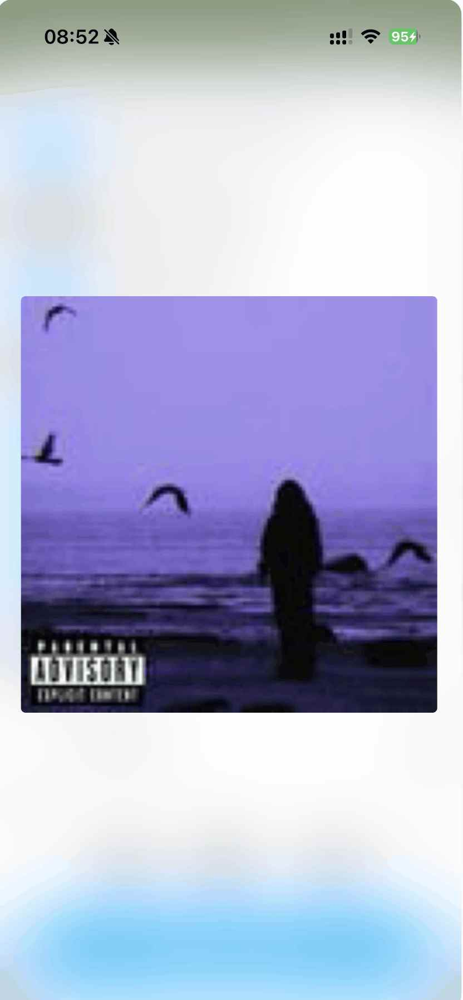
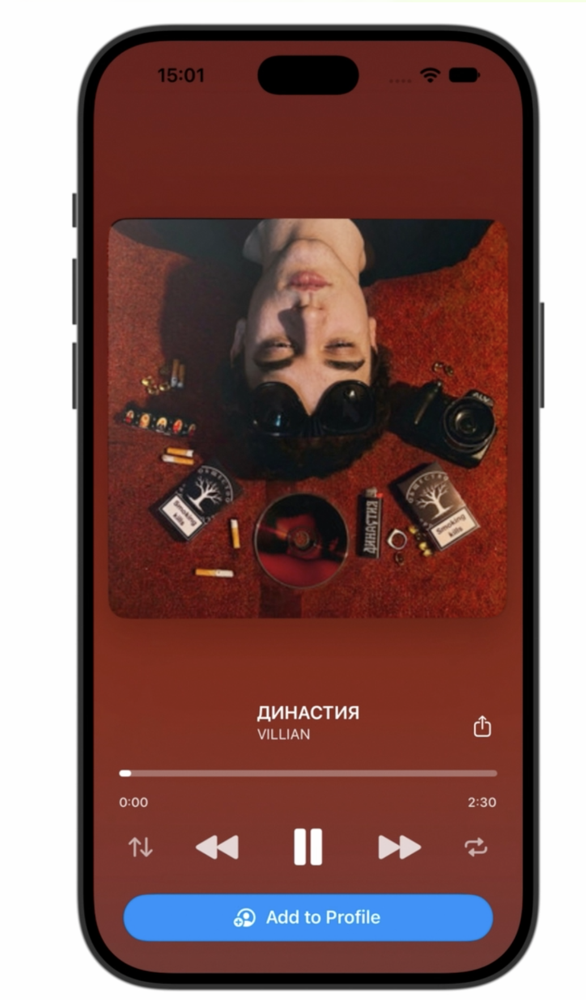

# Music Player V2


## 1. How apply to telegram-ios source code
```
# clone telegram-ios https://github.com/TelegramMessenger/Telegram-iOS

git checkout 24638bc69b

# apply changes http://github.com/col3name/timequoute-voice-message/blob/feature/stream-dynamic-island/changes.patch
git apply changes.patch
```

## 2.  Run ios demo app with player mechanics (fast way without build heavy entire telegram-ios app)


SwiftUI-демо плейлиста песен в стиле Telegram и полноэкранного музыкального плеера с жестами и анимациями.

Это визуальный прототип, а не клиент Telegram и не интеграция с его API. Приложение воспроизводит встроенные демонстрационные аудиофайлы MP3 и M4A. Плейлист и действия с профилем локальные.

## До и после

| До                           | После                          |
|------------------------------|--------------------------------|
|  |  |

[Видео демо](docs/media/music-v2.1-demo.mp4)

## Возможности

- Раскрытие и закрытие плеера жестами с анимированным переходом обложки.
- Переключение треков свайпом по обложке.
- Ambient Mode с мягким размытым фоном из обложки.
- Воспроизведение, пауза, перемотка, громкость, перемешивание и повтор.
- Анимированный полет постера

## Запуск

1. Откройте `MusicHeroSheet.xcodeproj` в Xcode.
2. Выберите схему **MusicHeroSheet** и симулятор iPhone с iOS 17 или новее.
3. Нажмите **⌘R**. Для запуска на iPhone настройте команду разработки в **Signing & Capabilities**.

Сборка из терминала на macOS:

```sh
xcodebuild -project MusicHeroSheet.xcodeproj \
  -scheme MusicHeroSheet \
  -sdk iphonesimulator \
  -destination 'generic/platform=iOS Simulator' \
  CODE_SIGNING_ALLOWED=NO build
```

Сервер и внешние пакеты не нужны. Аудиофайлы находятся в `MusicHeroSheet/Audio/`, список треков — в `MusicHeroSheet/DemoTrack.swift`.

English version: [README.md](README.md).
