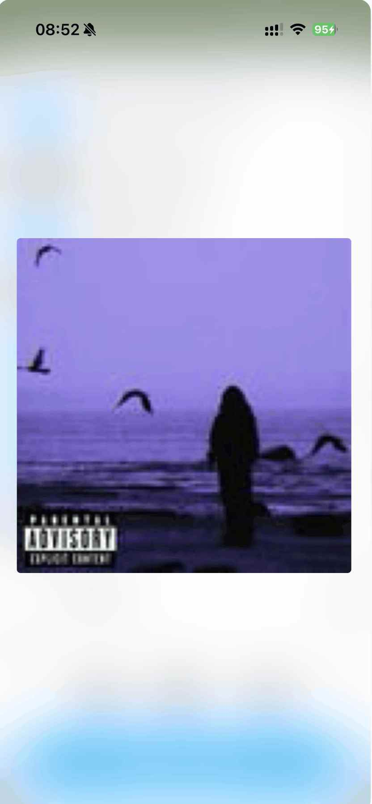
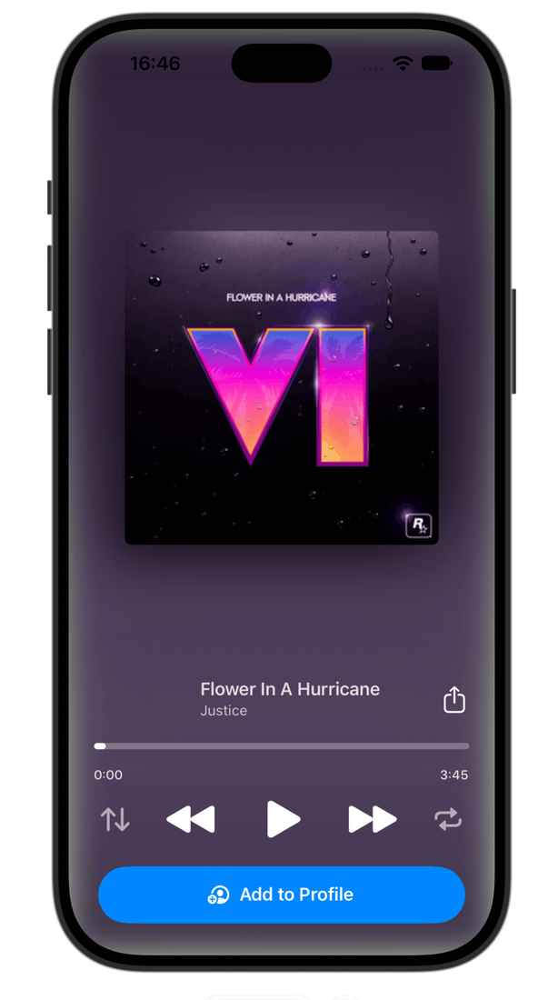

# Music Hero Sheet

A SwiftUI demo exploring a Telegram-style song playlist and an animated full-screen music player.

This is a visual prototype, not a Telegram client or API integration. It plays demo audio bundled with the app (MP3 and M4A files); playlists and profile actions are local UI examples.

## Before & After

| Before | After |
| --- | --- |
|  |  |

## Features

- Expand and dismiss the player with gestures and animated artwork transitions.
- Swipe across the artwork to change tracks.
- Ambient Mode adds a soft, blurred artwork background.
- Playback controls include play/pause, scrubbing, volume, shuffle, and repeat.

## Run

1. Open `MusicHeroSheet.xcodeproj` in Xcode.
2. Select the **MusicHeroSheet** scheme and an iOS 17+ iPhone simulator.
3. Press **⌘R**. For a physical device, configure your development team under **Signing & Capabilities**.

Or build from Terminal on macOS:

```sh
xcodebuild -project MusicHeroSheet.xcodeproj \
  -scheme MusicHeroSheet \
  -sdk iphonesimulator \
  -destination 'generic/platform=iOS Simulator' \
  CODE_SIGNING_ALLOWED=NO build
```

No external packages or server are required. The player uses local audio files in `MusicHeroSheet/Audio/`; track metadata is defined in `MusicHeroSheet/DemoTrack.swift`.

Русская версия: [README-ru.md](README-ru.md).
